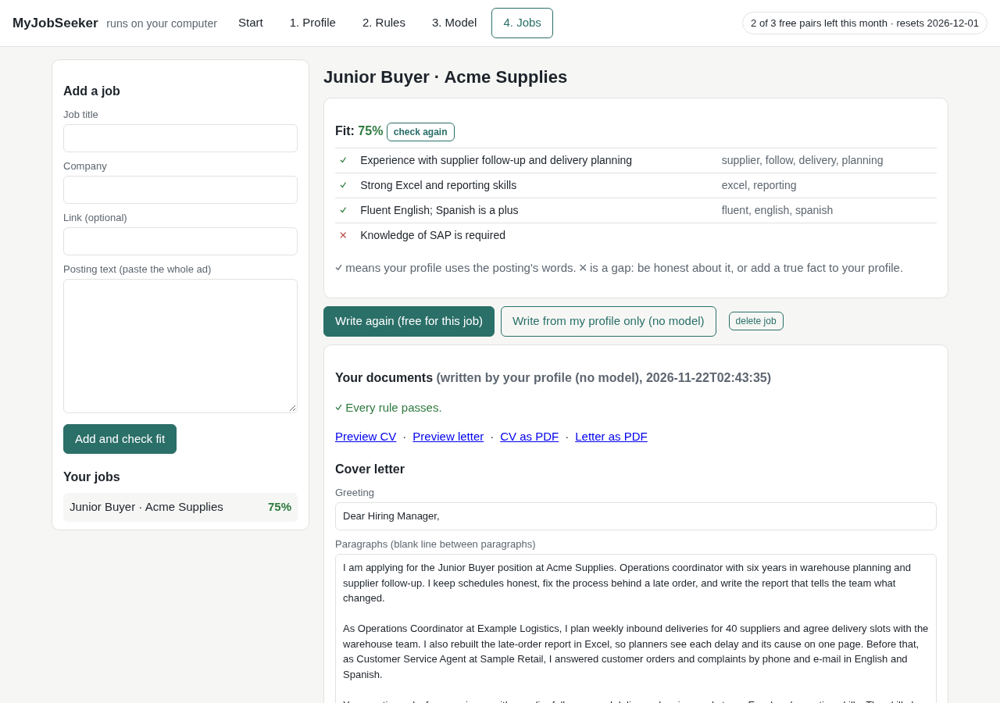

# MyJobSeeker

**Paste a job ad. See how well you fit. Get a tailored CV and cover letter that only says true things about you.**

MyJobSeeker is a small app that runs on your own computer. You fill in your profile once, set your writing rules,
and for each job it checks the fit, writes a CV and cover letter, checks them against your rules, and gives you PDFs.
No account, no upload, no subscription.

<p align="center">
  
</p>

## Free tier

| | |
|---|---|
| CV + cover letter pairs | **3 per calendar month** (the count starts again on the 1st) |
| Writing the same job again | free |
| Editing your documents | free, unlimited |
| Fit checks, rule checks, PDFs | free, unlimited |
| Your data | stays on your computer |

The limit is counted on your computer, in your data folder. There is no server and nothing to sign up for.

## Start in two minutes

You need **Python 3.10 or newer**. Nothing else to install.

```bash
git clone https://github.com/osmanvarolus-art/myjobseeker-free.git myjobseeker
cd myjobseeker
./start.sh            # Windows: double-click start.bat
```

Your browser opens at `http://127.0.0.1:8377`. The app walks you through four steps:

1. **Profile.** Your jobs, what you did in each, education, skills and languages. Click *Fill with the example
   person* to see what a good profile looks like, then replace it with your own facts.
2. **Rules.** Phrases you never want to see ("I am writing to apply", "passionate"), things every letter must say
   (your availability, your work permit), letter length and sentence length. Sensible rules are already set.
3. **Model** (optional). Connect a language model on your computer for more tailored writing. Without one, the app
   still writes a clean first version from your own profile text.
4. **Jobs.** Paste a job ad. You get a fit score with every requirement marked ✓ (your profile covers it) or ✗ (a
   gap). Click **Write CV + cover letter**, edit anything you like, and download the PDFs.

## Why the documents stay true

Every CV and letter goes through your rules before you see it. The checks are plain code, not a model's opinion:

- **No invented numbers.** Any figure that is not in your profile is flagged ("cut costs by 37%" when your profile
  never says 37).
- **No invented employers.** The CV may only name companies that are in your profile.
- **Your banned phrases** and **your must-mention items** are checked on every version.
- **Length and sentence limits** keep letters readable.

When a model breaks a rule, the app sends the list of problems back and asks it to repair them once. Anything still
wrong is shown in red next to your document, so you decide.

## Connect a model (optional)

The app only talks to a model **on your own computer**. It refuses any internet address, so it can never run up a bill.

**Ollama (free, local):**

```bash
ollama pull qwen3:8b
```

In the app: *Model* → *A local model server* → address `http://127.0.0.1:11434`, model `qwen3:8b` → *Test the model*.
LM Studio and llama.cpp work the same way (any OpenAI-compatible server on localhost).

**A command-line tool you already pay for** (Claude Code, Codex CLI, Gemini CLI): *Model* → *A command I already use*
→ for example `claude -p`. The prompt goes to the command's input and the answer is read from its output.

## PDFs

If Chrome, Chromium, Brave or Edge is installed, *CV as PDF* and *Letter as PDF* download ready files. If not, open
*Preview CV* or *Preview letter* and use your browser's **Print → Save as PDF**. Both are A4 and print-ready.

## Your data

Everything lives in one folder outside this repository: `~/.myjobseeker` (change it with `MYJOBSEEKER_HOME`).

```
~/.myjobseeker/
  profile.json    your facts
  rules.json      your writing rules
  settings.json   your model choice
  usage.json      this month's count
  jobs/           one file per job, with every version you wrote or edited
```

Because it is outside the repository, you can fork or update the code without ever committing your personal data.
Back up that folder to keep your work; delete it to start over.

## Settings

| Variable | What it does | Default |
|---|---|---|
| `MYJOBSEEKER_HOME` | your data folder | `~/.myjobseeker` |
| `MYJOBSEEKER_PORT` | the local port | `8377` |
| `MYJOBSEEKER_BROWSER` | the browser used for PDFs | first one found |

The app answers only on `127.0.0.1`. Other computers on your network cannot open it.

## For power users: the Claude Code workflow

This repository is built on [ai-job-search](https://github.com/ai-job-search-dev/ai-job-search) by Mads Lorentzen.
Its full Claude Code workflow (`/setup`, `/scrape`, `/rank`, `/apply`, `/interview`, `/outcome`, LaTeX templates, job
portal search tools) is still here. Read [docs/CLAUDE_CODE_WORKFLOW.md](docs/CLAUDE_CODE_WORKFLOW.md) to use it. The
monthly limit above applies to the MyJobSeeker app.

## Development

```bash
python3 -m pytest tests/test_myjobseeker_app.py      # the app
python3 -m pytest tests                              # everything
```

The app is one Python file (`app/myjobseeker.py`, standard library only) plus a static page in `app/static/`.

## License

MIT. See [LICENSE](LICENSE). Original framework © Mads Lorentzen and the ai-job-search contributors.
